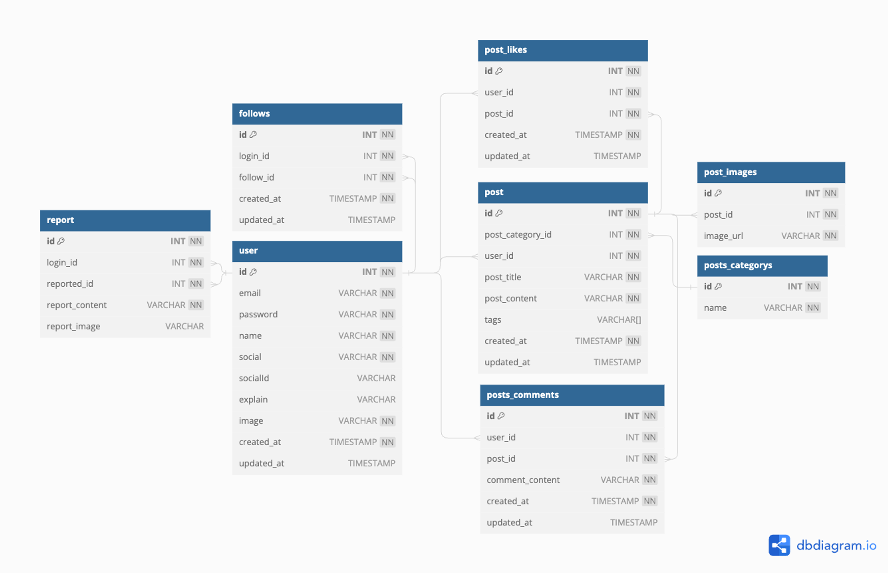

  

  
  &nbsp;&nbsp;
  
  &nbsp;&nbsp;
  
  &nbsp;&nbsp;
  
   
  
  &nbsp;&nbsp;
  
  &nbsp;&nbsp;
  
    
  &nbsp;&nbsp;

# 🖥️ 패션 커뮤니티 플랫폼

## 프로젝트 소개

- 프로젝트 이름 : 패션 커뮤니티 플랫폼
- 내용 : 연예인, 사진으로 이쁜옷이나 관심있는 옷들을 찾고싶을때 유저들끼리 서로 공유하며 원하는 옷의 정보들을 공유하는 플랫폼입니다.
  

- 구분 : 개인 프로젝트
- GitHub : [lgochaja](https://github.com/fierceCry/lgoChaJa_NestJs)
  
 

## 1. 개발 기간

- 2024.02.21 ~ 2024.04.20

 

# ERD 

## 2. 기능

- 회원가입
- 로그인 (session)
- 네이버 소셜 로그인
- 카카오 소셜 로그인
- 구글 소셜 로그인
- 이메일 찾기 (nodemailer)
- 패스워드 찾기
- 내 프로필 상세
- 패스워드 변경
- 팔로우, 팔로잉
- 프로필 이미지 수정( AWS S3)
- 프로필 상세
- 팔로우 리스트
- 팔로워 리스트
- 게시글 CRUD
- 댓글 CRUD
- 메인리스트 조회
- 카테고리 별 조회
  

